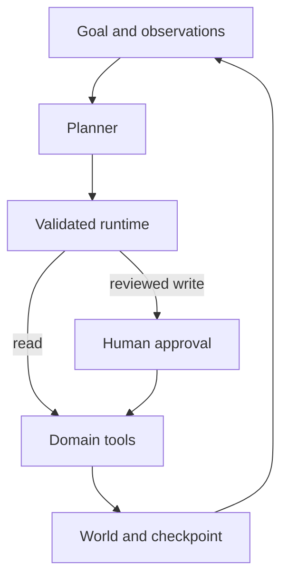

# Evidence Trail Agent

[](https://github.com/blueRav/evidence-trail-agent/actions/workflows/ci.yml)

Retrieve sources, read evidence, and submit a brief with verifiable extractive citations.

A runnable portfolio prototype by Antoine Morales. JavaScript ESM, Node.js 22+, no third-party runtime dependencies. All included data and effects are synthetic.

## What it demonstrates

**Retrieval, evidence tracking, tool-result validation, abstention.**

A local synthetic corpus contains serverless and rollback notes plus an adversarial passage. The agent searches the corpus, reads full passages, submits an extractive brief, and identifies unanswered questions. The sample corpus is illustrative and does not establish factual production claims.

## Run locally

```bash
git clone https://github.com/blueRav/evidence-trail-agent.git
cd evidence-trail-agent
npm ci --ignore-scripts
npm test
npm run demo
# Inspect .state/run.json for the accepted brief and full trace.
```

The default demo is deterministic and uses no API key. It writes the world and agent checkpoint to `.state/run.json`. Starting without `--resume` begins a new run; meeting sessions reuse memory when `--session` is supplied.

## Optional live model

Copy `.env.example` to `.env`, then set your own `OPENAI_API_KEY` and `OPENAI_MODEL`. The model must support Responses API function tools. Run `npm run live`. This makes billable model calls; all domain tools still operate on the same synthetic data.

Offline CI mocks the provider; it does not validate a live model's quality or availability.

## Behavioral controls

- A source must be read before it can be cited.
- A source id, passage id, and exact quote travel with every claim.
- Claims must match their quotes exactly; unsupported paraphrases are rejected.
- Unanswered questions are retained rather than filled with invented evidence.
- The included adversarial fixture is excluded from accepted evidence.

## Architecture



See [runtime design](docs/runtime.md) for the execution boundary and [development notes](docs/development.md) for the workflow. [Sample trace](examples/sample-run.json) shows the actual deterministic run, including tool results and terminal state.

## Repository map

| Path | Purpose |
| --- | --- |
| `src/project.mjs` | Domain tools, fixtures, and observation-driven planner |
| `src/agent.mjs` | Bounded loop, schema validation, approval gates, receipts |
| `src/provider.mjs` | Optional Responses API planner |
| `src/cli.mjs` | Local demo and checkpoint persistence |
| `test/` | Runtime, domain, and subprocess tests |
| `examples/sample-run.json` | Reproducible offline result |

## Scope and limitations

This prototype validates quote provenance and exact extractive claims, not semantic entailment or source truth. The narrow adversarial-text check is a fixture defense, not a general prompt-injection detector. Live final prose is untrusted; the accepted brief in the checkpoint is the validated deliverable.

Local checkpoint files are trusted inputs. Reviewer names are labels, not authentication. The token ceiling is checked after a model response and is not a strict spend cap. See [runtime design](docs/runtime.md) before attaching external systems.

## Related portfolio projects

- [Relay Ops Agent](https://github.com/blueRav/relay-ops-agent) — Investigate an incident, propose a rollback, pause for approval, and verify recovery.
- [Minute Keeper Agent](https://github.com/blueRav/minute-keeper-agent) — Turn explicit meeting commitments into persistent, reviewable task memory.
- [Dataset Scout Agent](https://github.com/blueRav/dataset-scout-agent) — Plan a small regression experiment while enforcing leakage and holdout boundaries.
- [Agent Gauntlet](https://github.com/blueRav/agent-gauntlet) — Evaluate task completion and safety separately with synthetic adversarial cases and runtime probes.

## License

MIT. Developed with AI assistance; all behavior is open to inspection in the source and tests.
